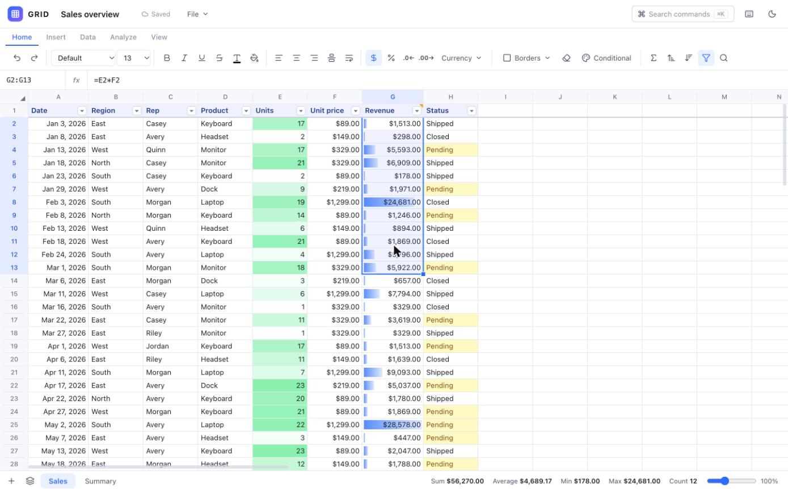

# GRID

A fast, modern spreadsheet that runs in the browser. It has a real formula engine,
dynamic arrays, pivot tables, charts and data-analysis tools, all in a calm,
keyboard-friendly interface with light and dark themes.



## Highlights

**Calculation engine**
- A real tokenizer and parser that builds a syntax tree. There is no `eval` and no string-substitution trickery.
- A dependency graph with **incremental, topologically ordered recalculation**. Only the cells affected by an edit are recomputed, and long dependency chains are handled iteratively, so deep chains cannot overflow the stack.
- **Circular reference detection**, reported in the status bar, with `#CIRC!` on the affected cells.
- **Dynamic arrays**: results spill into neighbouring cells, show `#SPILL!` when the spill area is blocked, and operators and scalar functions broadcast over arrays.
- Relative, absolute and mixed references (`A1`, `$A$1`, `A$1`, `$A1`), whole columns and rows (`A:A`, `3:3`), cross-sheet references (`'Q1 Data'!B2:B90`), named ranges and `LET`.
- References stay correct when rows or columns are inserted or deleted, when sheets are renamed or deleted, and when cells are moved, sorted, copied or filled.
- Full error propagation, with a plain-language explanation of every error.
- **200+ functions** across math, logical, lookup, text, statistical, date & time, dynamic-array, financial and information categories. They include `XLOOKUP`, `XMATCH`, `FILTER`, `SORT`, `SORTBY`, `UNIQUE`, `SEQUENCE`, `TEXTSPLIT`, `SUMIFS`, `COUNTIFS`, `IRR`, `XIRR`, `RATE`, `NETWORKDAYS`, `DATEDIF` and many more.

**Editing**
- A canvas-rendered grid with smooth scrolling, zoom from 50 % to 200 %, frozen panes, and 5,000,000 rows × 18,278 columns.
- In-cell and formula-bar editing with **function autocomplete**, **argument hints**, **colour-matched reference highlighting**, **point-and-click / arrow-key reference entry** and F4 to cycle `$` anchoring.
- Multi-range selection, the fill handle (it extends number, date, text+number, month and weekday series, and shifts formulas), drag to move cells, copy/cut/paste with paste-values, paste-formats and transpose, and `Ctrl+Enter` to fill a selection.
- Undo and redo for every operation, including structural changes.
- Find and replace across one or all sheets, in values or in formulas.
- Resizing and auto-fit, hiding and unhiding, inserting and deleting rows and columns, sheet management (add, rename, duplicate, reorder, colour, delete).
- Rich formatting: fonts, sizes, bold, italic, underline, strike, colours, fills, borders, alignment, wrapping, and a full number-format engine (currency, accounting, percent, scientific, dates, times, durations, custom codes with colours and sections).
- Comments on cells, a command palette (`Ctrl/⌘+K`) that searches commands, functions and cell contents, and a formula view.

**Data analysis**
- **Pivot tables** with row, column and value fields and eight aggregations, refreshable, plus **pivot charts**.
- **Charts**: column, bar, stacked, line, area, pie, doughnut and scatter. They stay linked to live data and can be dragged and resized.
- **Row and column grouping**: nested outline groups with +/− toggles in the headers, collapse/expand all, and `Alt+Shift+→` / `Alt+Shift+←` to group and ungroup.
- Filters with value lists and conditions, an **advanced filter** with AND/OR rules (filter in place or copy out), and **multi-column sorting**.
- **Conditional formatting**: comparisons, text rules, top/bottom N, above/below average, duplicates and uniques, date rules, custom formulas, colour scales and data bars.
- **Data validation**: dropdown lists (typed or from a range), number, whole-number, date and text-length rules, checkboxes and custom formulas, with either reject or warn behaviour.
- **What-if analysis**: goal seek, plus a scenario manager with a summary report.
- **Statistics**: descriptive statistics, correlation matrix, and a linear-trend **forecast** with 95 % prediction intervals and a chart.
- **Data cleaning**: remove or highlight duplicates, trim, remove hidden characters, change case, convert text to numbers, fill blanks down, remove blank rows, split text to columns, and live `SUBTOTAL` reports.
- **Import / export**: CSV and TSV import with delimiter detection, CSV/TSV export, and a native `.grid` workbook format. Drag a file onto the window to open it. Work is saved automatically in the browser.

## Getting started

```bash
npm install
npm run dev        # start the app at http://localhost:5173
npm test           # run the engine and feature test suites
npm run build      # type-check and produce a production build in dist/
```

The first launch opens a sample workbook so every feature is easy to try.

## Architecture

```
src/
  engine/              pure TypeScript, no UI dependencies
    parser.ts          tokenizer, parser, printer, reference transforms
    evaluate.ts        evaluator, function registry, array broadcasting
    workbook.ts        sheets, dependency graph, recalculation, spills, undo/redo, persistence
    functions/         function library by category
    format.ts          number-format engine
    dates.ts           date serials and parsing
    features/          filters, conditional formats, validation, autofill, pivots, analysis, CSV
  app/
    render.ts          canvas renderer (panes, text overflow, formats, selection, highlights)
    components/        grid, formula editor, toolbar, panels, charts, dialogs
tests/                 engine, feature and performance tests
docs/                  compatibility notes and the reverse-engineering log
```

## Documentation

- [Formula compatibility and documented differences](docs/COMPATIBILITY.md)
- [Reverse-engineering investigation log](docs/REVERSE_ENGINEERING.md)

## License

MIT
